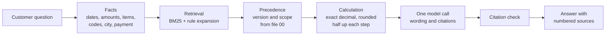

# Policy Desk

**Customer support that answers from your policies, shows its working, and never makes up a rule.**

Policy Desk answers customer questions about returns, refunds, shipping, warranty, payments, promo codes, privacy and seller rules for NovaCart, an online store with 22 policy documents. Every line of an answer cites the file and section it comes from. Money and dates are worked out in code, not by the language model. When the policies do not answer a question, it says so.

Built in four hours for Challenge A of Tech Fusion '26 (Bahria University Islamabad, 14 November 2026).

| | |
| --- | --- |
| Answer service | `api/` · Python, FastAPI |
| Support desk and site | `web/` · Next.js |
| Knowledge base | `policies/` · the 22 NovaCart policy files, read as they are |
| Live API health | https://api-gray-eight-83.vercel.app/health |

---

## Contents

1. [Why a shop needs this](#why-a-shop-needs-this)
2. [One question, answered](#one-question-answered)
3. [What it will not guess](#what-it-will-not-guess)
4. [How an answer is made](#how-an-answer-is-made)
5. [The support desk](#the-support-desk)
6. [Staying up when the model provider does not](#staying-up-when-the-model-provider-does-not)
7. [Run it](#run-it)
8. [Deploy it](#deploy-it)
9. [Configuration](#configuration)
10. [Repository layout](#repository-layout)
11. [The policy set](#the-policy-set)

---

## Why a shop needs this

A support agent answering a refund question has to know which returns policy is current, whether the promo code changes the refund, which fees are kept, and whether the customer's city has its own rules. Most mistakes in support are not rudeness. They are a wrong number or an out-of-date rule, given confidently.

Policy Desk is built for that problem.

| What the shop owner gets | How |
| --- | --- |
| **Answers that match the written policy** | The assistant may only use text from the policy files. It cannot fall back on general knowledge about other stores. |
| **Every figure can be checked** | Each answer carries numbered source markers. Click one and the exact policy section opens. The calculation is shown step by step with the rule behind each step. |
| **Refund and fee amounts that are right to the rupee** | Discount splits, restocking fees, return fees, shipping thresholds and warranty pro-rata are computed in code with exact decimal arithmetic and the rounding rule from the policies. |
| **No promises the policy does not make** | If the files do not cover something, the customer is told "this is not covered" instead of an invented answer. |
| **The right version of a policy, on the right date** | When two versions of a policy exist, the one in force on the customer's dates is used, and the customer is told the files differ. |
| **One short question instead of a wrong answer** | If a missing detail (city, order date, payment method) would change the outcome, the desk asks for that one detail. If it would not, it answers. |
| **Change a policy, change the answers** | Edit a policy file and the index rebuilds on the next start. There is no model to retrain. |
| **Low running cost** | One language-model call per answer, on free-tier providers, with an automatic fallback provider. |

---

## One question, answered

> I ordered a shirt (Rs. 2,400) and trousers (Rs. 3,600) on 2026-06-28 with code STYLE15 and paid by card. They were delivered to Lahore on 2026-07-01. Today is 2026-07-10 and I want to return the shirt. It's unworn with the tags on. How much do I get back?

**Answer**

> Yes, you can return the shirt until 2026-07-31 and get Rs. 1,840 [1]: paid Rs. 2,040 after its Rs. 360 share of STYLE15 [2]; no restocking fee [3]; minus the Rs. 200 return label fee [4].
> It goes back to your card within 7 business days of passing inspection [5], or you can take Rs. 1,932 in store credit with the 5% bonus [6].

**Working shown to the agent**

| Step | Working | Result | Rule |
| --- | --- | ---: | --- |
| Eligible subtotal | 2,400 + 3,600 | 6,000 | file 12, 3.1 |
| STYLE15 discount | 15% of 6,000, cap 1,500 | 900 | file 12, 3.2 |
| Shirt's share of the discount | 900 × 2,400 ÷ 6,000 | 360 | file 12, 6.1 |
| Shirt's paid price | 2,400 − 360 | 2,040 | file 01, 5.1 |
| Restocking fee, clothing | | 0 | file 01, 3.2 |
| Return label fee | | −200 | file 01, 4.1 |
| Refund to card | 2,040 − 0 − 200 | **1,840** | file 01, 5.3 |

**Why these rules and not others**

- Two returns policies exist (files 01 and 02). Both are general in scope, and file 01 has the later effective date and is in force on 2026-07-10, so it applies (file 00, 4.2). The customer is told the two files differ.
- STYLE15 was valid because the order date, not today's date, is before the code's last order date.
- The discount is split across items first, because a refund starts from the item's paid price.
- The shipping fee is kept on a partial return (file 03, 2.1).

Every figure in this example was checked by hand against the policy files.

---

## What it will not guess

| Situation | What the desk does |
| --- | --- |
| The files do not cover the question | Says "this is not covered" and answers any part that is covered |
| A detail that changes the outcome is missing | Asks one question for that detail, then answers |
| Two policy versions disagree | Uses the one in force on the customer's dates and says the files differ |
| Two files with the same date and scope disagree | Shows what each file says and tells the customer support must confirm |
| A rule is not yet in force on the stated date | Ignores it, even if it is the newest file |
| A promo or sale has expired | Checks validity against the order date, not the day of the question |
| Text inside a policy file is written to an AI system rather than to customers | Keeps it out of the evidence and logs it |
| The evidence would not fit in the model's budget | Asks the customer to narrow the question rather than silently dropping rules |
| Both model providers are down | Returns the policy sections that cover the question and any calculated amount |

The clock is always the date in the question. The server's own date is never used to decide which rule applies.

---

## How an answer is made

The language model writes sentences. Everything that has to be exact is done in code first.



1. **Facts** (`api/app/facts.py`). Dates, amounts, items, promo codes, city or country, product category, seller, payment method and item condition are read from the message by deterministic parsers and kept for the conversation.
2. **Retrieval** (`api/app/retrieval.py`). BM25 search over every numbered policy item, then a rule-based expansion that pulls in regional and marketplace rules, cross-referenced sections, every competing version of a rule, and the file 00 conventions the facts call for. The top results are where the search starts, not a limit on the evidence.
3. **Precedence** (`api/app/precedence.py`). Applies file 00 using only each file's own front matter: a file counts from its effective date; a regional addendum wins for its region; within the same scope the later date wins; on the same date the more specific scope wins; same date and same scope is reported as unresolved.
4. **Calculation** (`api/app/calc.py`, `api/app/rules.py`). Whole rupees, rounded half up at every step, in the checkout order set by file 00. Every rule value used is tied to its file and section. If an input is missing, the calculator asks for it instead of guessing a number.
5. **One model call** (`api/app/gateway.py`, `api/app/prompt.py`). The model receives the facts, recent turns, tagged evidence, precedence decisions and the finished calculation. It copies the numbers, cites the tags, and keeps the answer to two lines. Citations are checked against the evidence afterwards; anything that does not match is replaced and logged.

---

## The support desk

The web app has two separate parts: a public site at `/` that explains the product, and the desk agents use at `/app`.

| Page | What an agent sees |
| --- | --- |
| `/app` | Ask a question. The answer comes with numbered sources, the details read from the question, the version check, the rule order and the calculation. |
| `/app/policies` | All 22 policy files, with a date control that shows which files are in force on that date |
| `/app/policies/NN` | One policy file, item by item, with links between cross-references |
| `/app/conflicts` | Every place two files disagree, and the file 00 rule that settles it |
| `/app/evaluation` | Test results, read from the latest evaluation run. It shows nothing until a run exists, never placeholder numbers. |

Without an API configured, the desk runs in preview mode on four hand-checked sample answers, and each one is labelled as a preview.

---

## Staying up when the model provider does not

Free-tier language models have rate limits and outages. All model calls go through one gateway:

- A primary provider and an optional fallback, both OpenAI-compatible, chosen by configuration.
- Failover on rate limits, server errors, timeouts, authentication errors and missing models, but only before the first word is streamed, so an answer is never stitched from two models.
- `Retry-After` is honoured; otherwise exponential backoff with jitter.
- A concurrency limit queues bursts instead of tripping rate limits.
- After three primary failures in a row, a circuit breaker sends traffic to the fallback for 60 seconds.
- If both providers fail, the customer still gets the relevant policy sections and any calculated amount.

`GET /health` reports whether chat is enabled, how many policy files and sections are loaded, index readiness, provider configuration and the circuit-breaker state. It never shows keys.

---

## Run it

**With Docker**

```bash
cp .env.example .env        # then add PRIMARY_LLM_API_KEY
docker compose up --build   # desk at http://localhost:3000
```

**Without Docker**

```bash
cd api
pip install -r requirements.txt
uvicorn app.main:app --port 8000
```

```bash
cd web
npm install
echo NEXT_PUBLIC_API_URL=http://localhost:8000 > .env.local
npm run dev
```

---

## Deploy it

```bash
node scripts/deploy.mjs
```

On Windows, double-clicking `scripts/deploy.cmd` does the same. The script:

1. reads `.env` and stops with a clear message if a required setting is missing;
2. creates the web project on Vercel if needed (root directory `web`) and points it at the API;
3. copies the settings from `.env` to the API project and adds the web address to the allowed origins;
4. deploys both from GitHub `main` and waits for the builds, printing the build log if one fails;
5. checks that `/health` reports chat enabled, that the API accepts requests from the web address, and that the site loads.

It needs `VERCEL_TOKEN` in `.env` (create one at vercel.com/account/tokens). Push your changes first: Vercel builds what is on GitHub. `--dry-run` checks everything and changes nothing; `--api-only` skips the web app.

---

## Configuration

Settings are read from the environment at startup. `.env.example` lists every one with a comment, and `.env` is git-ignored.

| Variable | Required | Purpose |
| --- | --- | --- |
| `PRIMARY_LLM_PROVIDER` | yes, or a base URL | `groq`, `gemini`, `openrouter` or `openai` |
| `PRIMARY_LLM_API_KEY` | yes | Key for the primary provider |
| `PRIMARY_LLM_MODEL` | yes | Model name |
| `FALLBACK_LLM_*` | no | Same settings for the fallback provider |
| `ALLOWED_ORIGINS` | no | Web addresses allowed to call the API |
| `APP_TIMEZONE` | no | Used for "today" when the customer gives no date |
| `NEXT_PUBLIC_API_URL` | web only | API address; empty means preview mode |
| `VERCEL_TOKEN` | deploy only | Used by `scripts/deploy.mjs`, never sent to the app |

If the model settings are missing, the service still starts, `/health` reports the problem, and chat replies that it is not configured.

---

## Repository layout

```
.
├── api/                 answer service (FastAPI)
│   ├── app/
│   │   ├── main.py          routes: /ask, /chat/stream, /health
│   │   ├── pipeline.py      runs the steps below for one question
│   │   ├── sessions.py      per-conversation facts and turns
│   │   ├── facts.py         deterministic fact extraction
│   │   ├── retrieval.py     BM25 search and rule expansion
│   │   ├── precedence.py    file 00 version and scope rules
│   │   ├── calc.py          exact money and date calculations
│   │   ├── rules.py         rule values, each tied to file and section
│   │   ├── prompt.py        system prompt and citation checks
│   │   └── gateway.py       model providers, retries, fallback
│   └── policies/        copy of the policy files for serverless deploys
├── web/                 Next.js site (/) and support desk (/app)
├── policies/            the 22 NovaCart policy files (never edited)
├── scripts/             deploy.mjs, deploy.cmd
├── docker-compose.yml
└── .env.example
```

---

## The policy set

NovaCart is a fictional online store. Its 22 policy files are the only knowledge the desk uses. They are read as they are and never edited, because evaluation uses the originals.

| Topic | Files |
| --- | --- |
| How the policies fit together | 00 |
| Returns and refunds | 01, 02, 03, 04 |
| Shipping | 05, 06, 07, 21 |
| Warranty | 08, 09 |
| Payments | 10, 11 |
| Offers and promo codes | 12, 13, 14 |
| Privacy | 15, 16 |
| Seller rules | 17, 18 |
| Regional rules | 19, 20 |

File 00 sets the conventions the rest depend on: currency (whole Pakistani rupees, prices include 18% GST), rounding half up, how days and months are counted, regions and categories, checkout calculation order, which version is in force, and how conflicts are settled.

<details>
<summary>Full file index</summary>

| # | File | Covers |
| --- | --- | --- |
| 00 | `00_how_policies_work_together.md` | Conventions, regions, categories, versions, precedence, calculation order |
| 01 | `01_returns_policy.md` | Returns, version 3: windows, conditions, return fees, refund amount |
| 02 | `02_returns_policy_2025.md` | Returns, version 2 (2025 edition) |
| 03 | `03_refunds_policy.md` | Refunded fees, refund methods and timing, cancellations |
| 04 | `04_non_returnable_items.md` | Items that cannot be returned, and the exceptions |
| 05 | `05_shipping_policy.md` | Dispatch, delivery times, express and bulky delivery, failed deliveries |
| 06 | `06_shipping_fees_and_free_shipping.md` | Shipping fees, free-shipping thresholds, surcharges |
| 07 | `07_lost_or_damaged_deliveries.md` | Damaged, wrong, defective and lost deliveries |
| 08 | `08_warranty_policy.md` | Warranty periods, coverage, remedies |
| 09 | `09_warranty_claims.md` | How to claim, costs, repair time, appeals |
| 10 | `10_payments.md` | Payment methods, security, order limits |
| 11 | `11_cod_and_failed_payments.md` | Cash on delivery, COD fee, failed payments |
| 12 | `12_promo_code_rules.md` | Promo codes, eligibility, discount calculation and splitting |
| 13 | `13_sales_and_bundles.md` | Sale prices, flash sales, Final Sale, bundles |
| 14 | `14_store_credit.md` | Store credit, bonus, expiry, mixed payments |
| 15 | `15_privacy_policy.md` | Data collected, use, sharing, cookies, security |
| 16 | `16_data_requests_and_retention.md` | Data requests, deletion, retention |
| 17 | `17_seller_marketplace_rules.md` | Seller eligibility, commission, payout, dispatch |
| 18 | `18_seller_return_obligations.md` | Marketplace returns, seller warranty, penalties |
| 19 | `19_remote_areas_addendum.md` | Fees, delivery, returns and warranty for remote areas |
| 20 | `20_international_addendum.md` | Pricing, fees, returns and warranty for international orders |
| 21 | `21_shipping_fee_update_2027.md` | Shipping fee update announced for 2027 |

</details>

<details>
<summary>File format and citation unit</summary>

Each file opens with front matter:

```yaml
---
doc_id: NC-POL-06
title: Shipping Fees and Free Shipping
version: 2.0
effective_date: 2026-01-15
last_updated: 2026-01-05
scope: general
---
```

`scope` is `general`, `specific` or `regional`, as used by the precedence rules in file 00. Numbered items (`**3.2** ...`) are the unit the desk cites, for example `06_shipping_fees_and_free_shipping.md, Section 2.2`. A table belongs to the item that introduces it. Cross-references use the form `[file NN, Section X]`.

</details>

---

Tech Fusion '26 AI Hackathon · Challenge A · Bahria University Islamabad
